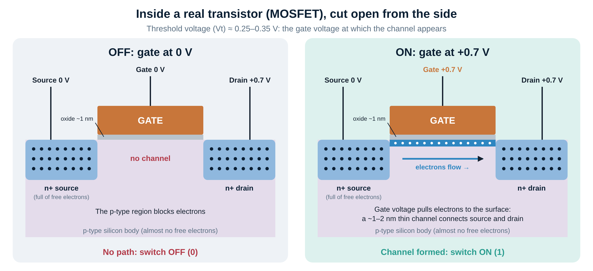
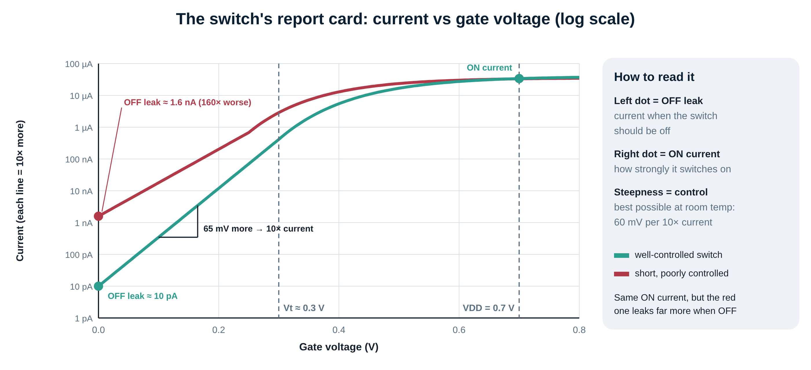
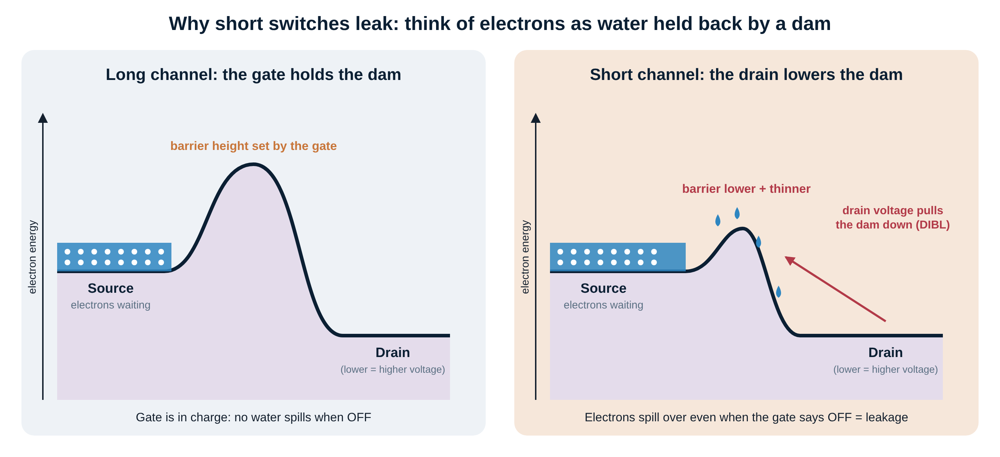
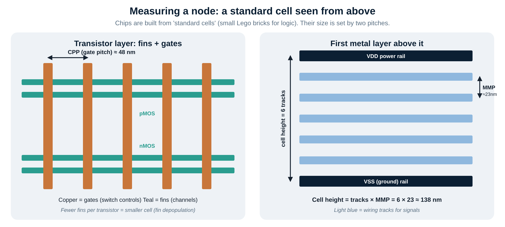
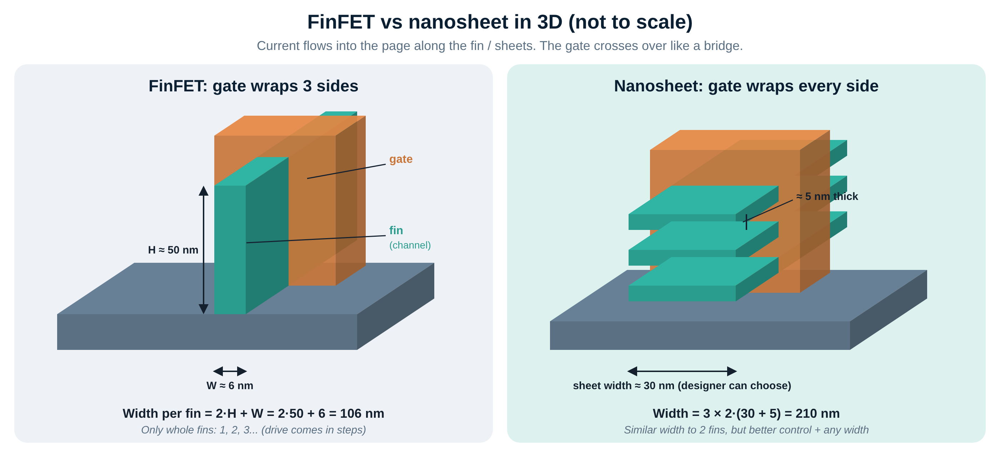
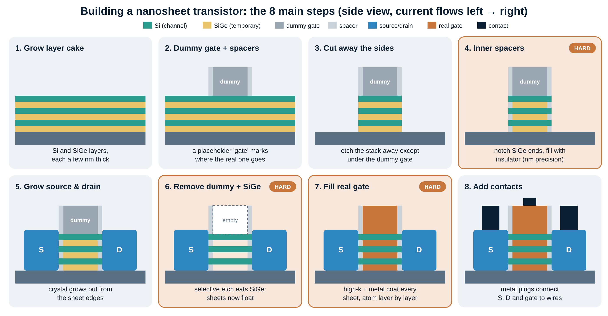
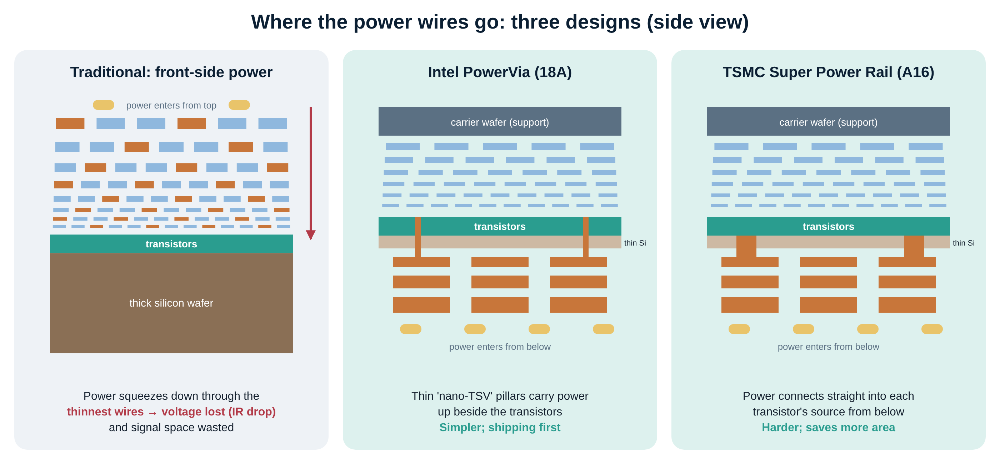
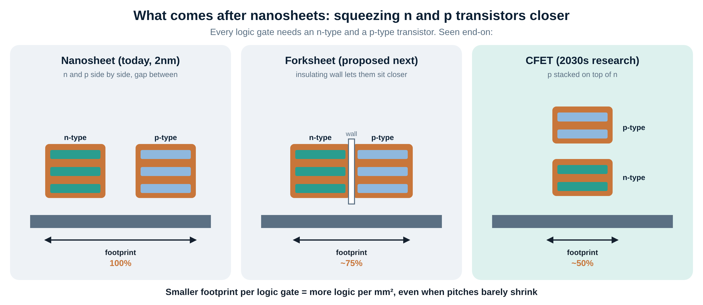

# Week 1 deep dive: inside the transistor

**Read the [beginner lesson](week-01-how-chips-work.md) first.** This part goes one level deeper on the same ideas, with the real physics, measurements and manufacturing steps.
Every technical term is explained in plain words the first time it appears. Look for the 💬 lines.

**Time:** ~2.5 hours, including practice problems.
**Goes with:** `weekly/week-01/week-01-deep-dive-slides.pptx` and the deep-dive podcast episode.

**Contents**
1. [How a transistor really works](#1-how-a-transistor-really-works)
2. [Why small transistors leak](#2-why-small-transistors-leak)
3. [How a node is measured](#3-how-a-node-is-measured)
4. [From FinFET to nanosheet](#4-from-finfet-to-nanosheet)
5. [Wiring and backside power](#5-wiring-and-backside-power)
6. [The industry view](#6-the-industry-view)
7. [Practice problems](#7-practice-problems)

---

## 1. How a transistor really works

The transistors in every modern chip are **MOSFETs** (metal-oxide-semiconductor field-effect transistors).
💬 *The name lists its layers from the top down: a **metal** gate, a thin **oxide** insulator, and the **semiconductor** silicon underneath. "Field-effect" means the gate controls current with an electric field, without touching the channel.*

### The parts

| Part | Plain words | Real detail |
|---|---|---|
| **Doping** | Adding a pinch of another element to silicon to change how it conducts | Phosphorus/arsenic give spare electrons (**n-type**); boron leaves gaps called holes (**p-type**) |
| **Source and drain** | Where current comes from and goes to | Heavily n-doped ("n+"), so they're full of free electrons |
| **Body** | The silicon between source and drain | p-type, with almost no free electrons, so nothing flows by default |
| **Gate oxide** | The insulator under the gate | ~1 nm of **high-k** hafnium oxide (HfO₂). It replaced SiO₂ around 2007 because SiO₂ that thin leaked current through it. |
| **Gate** | The control electrode, the tap handle | Several metal layers whose chemistry sets the threshold voltage |

### What happens when it switches on
1. **OFF** (gate at 0 V): the p-type body sits between the n+ source and the n+ drain. Electrons can't cross, so no current flows.
2. **ON** (gate at +0.7 V): the positive gate attracts electrons from the source and drain to the surface just under the oxide.
3. Once the gate voltage passes the **threshold voltage (Vt)**, enough electrons gather to form a conducting layer about 1–2 nm thick. This is the **channel** (engineers call it the *inversion layer*). Current flows.

💬 *Vt is like the minimum push needed to open a heavy door. Below it, almost nothing happens. Above it, the door swings open.*

### Two flavours: nMOS and pMOS → CMOS
- **nMOS** uses electrons and turns ON when the gate goes high.
- **pMOS** is the mirror image: it uses holes and turns ON when the gate goes low.
- Every logic gate pairs them (**CMOS**, complementary MOS). When idle, one of each pair is always OFF, so almost no current flows. That's why your phone can sit on standby for days.

---

## 2. Why small transistors leak

### The report card: the I–V curve

Engineers grade a transistor by plotting current against gate voltage, with current on a **log scale** where each grid line is 10× more.
💬 *A log scale lets you see a picoamp (a trillionth of an amp) and a hundred microamps on the same chart.*

| Number | Meaning | Why you care |
|---|---|---|
| **I_on** | Current at full gate voltage (VDD ≈ 0.7 V) | Higher means the transistor charges wires faster, so the chip runs faster |
| **I_off** | Current at 0 V, the leakage | Lower means better battery life and less heat. Billions of transistors × a tiny leak = watts. |
| **SS (subthreshold swing)** | Millivolts of gate voltage needed for a 10× current change | Steeper (smaller SS) means you can use a lower VDD |

### Why SS can't beat ~60 mV/decade

Electrons in the source don't all have the same energy. Like molecules in warm water, they have a spread set by temperature. Only the most energetic ones get over the barrier.
- The thermal voltage at room temperature is **kT/q ≈ 26 mV**.
- A 10× current increase needs **ln(10) ≈ 2.3** times that.
- **26 × 2.3 ≈ 60 mV per decade.** That's a law of physics for ordinary transistors.

Real transistors reach about 65–75 mV/decade. The worse the gate control, the bigger the number.

**Worked example.** You want 10× less leakage, so you raise Vt.
- At SS = 75 mV/dec you must raise Vt by 75 mV. At 60 mV/dec, only 60 mV.
- A higher Vt means you need a higher VDD to keep the same ON current.
- Power scales roughly with VDD², so a sloppy SS costs real battery life.

### Why short channels leak: the dam picture

Think of electron energy as height:
- The **source** is a reservoir of electrons.
- The **drain** is lower ground, because it's at a higher voltage.
- Between them is an energy **barrier**, a dam whose height the gate controls.

In a **long channel**, only the gate sets the dam height. In a **short channel**, the drain is so close that its voltage also pulls the dam down and makes it thinner. Electrons spill over even when the gate says OFF.

This is **DIBL (drain-induced barrier lowering)**. It's one of the *short-channel effects* that make Vt drop and leakage rise as transistors shrink.

### Three ways to give the gate back control

Engineers use a rule of thumb called the **natural length**:

λ ≈ √(ε_si · t_si · t_ox / (N · ε_ox))

The gate length should be several times λ. 💬 *In plain words: the smaller λ, the more the gate dominates the drain.* You can shrink it three ways:
1. **Thinner silicon (t_si):** less room for the drain's field to sneak under. This is why channels became 5–7 nm fins and then ~5 nm sheets.
2. **A better insulator (t_ox, ε_ox):** high-k oxides couple the gate more strongly.
3. **More gate sides (N):** 1 side (flat) → 3 (FinFET) → 4 (nanosheet). This is the biggest lever.

---

## 3. How a node is measured

Chips are assembled from **standard cells**: pre-designed blocks like a NAND gate or a flip-flop (a 1-bit memory element).
💬 *Think of them as Lego bricks. All bricks in a library have the same height so they snap into rows.*

| Measure | What it is | Typical "3nm-class" value |
|---|---|---|
| **CPP** (contacted poly pitch) | Distance between neighbouring gates. Cell width is a whole number of CPPs. | ~48 nm |
| **MMP** (minimum metal pitch) | Wire width + gap on the tightest metal layer | ~23 nm |
| **Tracks** | How many wire lanes fit in a cell's height | 6 or fewer |
| **Cell height** | tracks × MMP | 6 × 23 ≈ 138 nm |

### Pitches have nearly stopped shrinking

| Node | CPP (nm) | MMP (nm) |
|---|---|---|
| Intel 22nm (2011) | ~90 | ~80 |
| Intel 14nm | ~70 | ~52 |
| TSMC N7 | ~57 | ~40 |
| TSMC N5 | ~51 | ~28 |
| TSMC N3E | ~48 | ~23 |
| TSMC N2 | mid-40s (est.) | low-20s (est.) |

*Approximate published/analyst figures; they vary by source.* From N5 to N2, gate pitch moved only about 6 nm.

### So where does density come from? DTCO

**DTCO (design-technology co-optimisation)** means process engineers and cell designers change the rules *together*.
- **Fewer tracks:** 7.5 → 6 → 5 tracks cuts cell height from 172.5 → 138 → 115 nm at the same 23 nm pitch.
- **Fin depopulation:** 3 → 2 → 1 fin per transistor in the densest cells.
- **COAG (contact over active gate):** put the gate's contact directly above the transistor instead of off to the side.
- **Single diffusion break:** thinner isolation gaps between neighbouring cells.
- **Backside power:** removes power rails from the cell, freeing roughly one track (section 5).

### Density and the SRAM problem
- **Logic density** is measured in millions of transistors per mm² (MTr/mm²). One common formula is 0.6 × (NAND2 density) + 0.4 × (scan flip-flop density).
- **SRAM** is the fast on-chip memory (cache). Each bit uses 6 transistors. TSMC's reported high-density SRAM cell is ~0.021 µm² at both N5 and N3E, so it essentially didn't shrink. N2 reportedly gets only a modest improvement.
- **Why it matters:** AI chips need huge caches. If SRAM won't shrink, putting it on the most expensive process wastes money. That pushes designs toward **chiplets** and **stacked cache** (week 5).

---

## 4. From FinFET to nanosheet

**FinFET** (2011, Intel 22nm → TSMC N3):
- The channel is a thin vertical **fin**, and the gate drapes over 3 sides.
- Effective width per fin = **2·H + W** = 2·50 + 6 = **106 nm**.
- 💬 *Drive strength comes in whole fins: like buying water pipes only in fixed sizes.*

**Nanosheet / GAA (gate-all-around)** (Samsung SF3 2022, TSMC N2, Intel 18A):
- The channel is a stack of 3–4 horizontal **sheets**, each ~5 nm thick, with the gate wrapping all 4 sides.
- Effective width = **sheets × 2·(W + T)**.
- Samsung calls it **MBCFET**, Intel calls it **RibbonFET**, TSMC calls it **nanosheet**.

### Worked example: sizing

| Device | Formula | Effective width |
|---|---|---|
| 1 fin | 1 × (2·50 + 6) | 106 nm |
| 2 fins | 2 × (2·50 + 6) | 212 nm |
| 3 fins | 3 × (2·50 + 6) | 318 nm |
| 3 sheets × 15 nm | 3 × 2·(15 + 5) | 120 nm |
| 3 sheets × 30 nm | 3 × 2·(30 + 5) | 210 nm |
| 3 sheets × 45 nm | 3 × 2·(45 + 5) | 300 nm |

Raw width is similar. The wins are **better electrostatics** (lower SS, less DIBL) and **any width you like**. Library designers get continuous sizing back: narrow sheets for low-power cells, wide sheets for fast ones.

### How a nanosheet transistor is built

The whole trick is building around **placeholders**:
1. **Superlattice epitaxy.** Grow alternating Si (keeps) and SiGe (temporary) layers, each a few nm thick. 💬 *Epitaxy = growing a perfect crystal layer on top of another crystal.*
2. **Dummy gate + spacers.** A polysilicon placeholder marks where the real gate will go. Spacers are insulating walls on its sides.
3. **Cut away the sides.** Etch the stack away except under the dummy gate.
4. **Inner spacers** *(hard)*. Etch a few nm sideways into each SiGe layer and fill the notch with insulator. This stops the gate shorting to source/drain and cuts parasitic capacitance (unwanted charge storage that slows switching). It needs ~1 nm control everywhere on the wafer.
5. **Source/drain epitaxy.** Crystal grows out from the exposed sheet edges: phosphorus-doped Si for nMOS, boron-doped SiGe for pMOS.
6. **Remove dummy + channel release** *(hard)*. Remove the dummy gate, then a selective etch dissolves SiGe while barely touching Si (selectivity ≥100:1). The sheets now float, held at their ends.
7. **Replacement metal gate** *(hard)*. Use **ALD** (atomic layer deposition) to coat every sheet with high-k oxide and work-function metals inside ~10 nm gaps. 💬 *ALD = spraying a film one atomic layer at a time, so it coats every surface evenly, even inside narrow gaps.*
8. **Contacts.** Metal plugs connect source, drain and gate to the wiring above.

**Why step 7 limits "Vt flavours".** Designers like several threshold voltages: ultra-low and low for speed, standard and high for low leakage. Each usually needs a slightly different metal stack. With only ~10 nm between sheets there's no room for many layers. Libraries make up for it with gate-length biasing, sheet-width choices and other tricks.

### Who sells the tools

| Step type | Main toolmakers |
|---|---|
| Lithography (week 2) | ASML (sole EUV supplier) |
| Epitaxy | Applied Materials, ASM International |
| Deposition / ALD | ASM International, Lam Research, Tokyo Electron, Applied Materials |
| Etch | Lam Research, Tokyo Electron, Applied Materials |
| Metrology / inspection | KLA, Applied Materials, Onto Innovation |

GAA adds many epi, ALD, etch and metrology steps compared with FinFET. That's why toolmakers call it a growth driver.

---

## 5. Wiring and backside power

Above the transistors sit **15+ metal layers**, collectively the **BEOL** (back end of line).
- The bottom layers are tens of nm wide.
- At these sizes, copper's resistance rises sharply, because electrons bounce off the wire's edges and the barrier liner takes up much of the width.
- 💬 *Thinner straw, harder to drink through.* Many engineers now see wires, not transistors, as the main limit.

**IR drop.** Power traditionally enters from the top and must squeeze down through the thinnest, most resistive wires to reach each transistor. Voltage lost along the way is IR drop (current × resistance). Power rails also use up tracks inside every cell.

**Backside power delivery (BSPDN):**
1. Build the transistors and signal wiring as usual.
2. Bond the wafer face-down onto a carrier wafer.
3. Grind the original silicon down to almost nothing.
4. Build a thick, low-resistance power network on the back.

| | Intel PowerVia (18A) | TSMC Super Power Rail (A16) |
|---|---|---|
| Connection | Thin **nano-TSV** pillars (TSV = through-silicon via) run up beside the transistors | Power connects **directly** into each transistor's source/drain from below |
| Trade-off | Simpler; shipped first | Harder to make; saves more area |

**Gains:** less IR drop, about one extra signal track per cell, higher density and clock speed. That's a big deal for AI chips drawing hundreds of amps.

**Costs:**
- Wafer bonding and thinning.
- Hotspots get worse, because there's less silicon to spread heat.
- Debugging from the back is harder.
- New design flows: power-grid design, IR/EM sign-off (EM = **electromigration**, where high current slowly pushes metal atoms and can break a wire), thermal analysis, PDK and EDA tools.

### What comes after nanosheets

- **Forksheet** (proposed by imec): an insulating wall between n and p sheets lets them sit much closer. Roughly 75% of the footprint.
- **CFET** (complementary FET): stack the p-transistor directly on top of the n-transistor. Roughly 50% of the footprint. Expected in the 2030s.

---

## 6. The industry view

### The 2nm-class race

| Company | Node | Transistor | Backside power | Watch for |
|---|---|---|---|---|
| TSMC | N2 → A16 | Nanosheet | Super Power Rail (A16) | Volume ramp; Apple and HPC customers first |
| Intel | 18A | RibbonFET | PowerVia (first to ship) | Winning outside foundry customers |
| Samsung | SF3 → SF2 | MBCFET (first GAA, 2022) | Planned (SF2Z) | Yield and customer wins |

💬 *Yield = the share of chips on a wafer that work. A slow or low-yield ramp hurts the foundry's margins and delays its customers' products.*

**Compare** density, performance per watt, SRAM cell area, yield and wafer price, **not node names**.

### Career map

| Role | What they do | Why this week's topics matter |
|---|---|---|
| Standard-cell library designer | Designs and characterises the logic "Lego bricks" | New sheet-width and Vt options; new cell rules |
| DTCO engineer | Co-optimises process rules and cell layouts | Track reduction, backside rails |
| Physical design engineer | Places and routes blocks into the chip layout | New power grids, fewer tracks, congestion |
| Power-integrity / IR-EM engineer | Signs off voltage drop and wire wear-out | Backside power changes this job completely |
| Verification engineer | Proves the design works before **tape-out** (sending the final design to the fab) | More complex chips need more verification |

Many of these roles are hiring in design centres in Bengaluru, Hyderabad and Noida.

### Investing angle (not advice)
- **Foundries** charge more per wafer at the leading edge.
- **Toolmakers** sell more deposition, etch and metrology per wafer with GAA.
- **EDA** (chip-design software: Synopsys, Cadence, Siemens) sells more complex sign-off flows.
- **Key risk:** yield ramps.

---

## 7. Practice problems

1. A 6-track cell uses MMP = 21 nm. How tall is it?
2. Going from 6 to 5 tracks at the same pitch saves what percentage of cell area (same width)?
3. SS = 70 mV/dec. How much must Vt rise to cut leakage 100×?
4. What's the effective width of 4 sheets, each 25 nm wide and 5 nm thick?
5. Explain DIBL using the dam picture, in two sentences.
6. Why does nanosheet gate fill limit the number of Vt flavours?
7. Name one benefit and one cost of backside power for an AI chip.
8. Why does stalled SRAM scaling push the industry toward chiplets?

Answers

1. 6 × 21 = **126 nm**.
2. 1 − 5/6 ≈ **16.7%**.
3. 100× is 2 decades, so 2 × 70 = **140 mV**.
4. 4 × 2·(25 + 5) = **240 nm**.
5. The gate sets the height of an energy barrier between source and drain. In a short channel the drain's voltage also pulls that barrier down, so electrons leak over even when the gate says OFF.
6. Each Vt flavour needs a different work-function metal stack, and the ~10 nm gaps between sheets leave no room for several thick layers.
7. Benefit: less IR drop / more routing tracks / higher clock. Cost: worse hotspots / bonding and thinning complexity / harder debug.
8. If cache barely shrinks on an expensive new node, it's cheaper to put it on an older-node chiplet or stack it on top, rather than spend leading-edge area on it.

**Further reading:**
- IRDS "More Moore" roadmap
- imec research on nanosheet, forksheet, CFET and backside power
- WikiChip Fuse node write-ups
- IEDM and VLSI Symposium papers from TSMC, Intel and Samsung
- Semiconductor Engineering's knowledge centre
