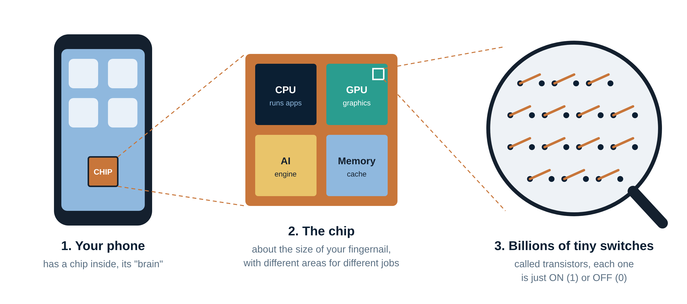
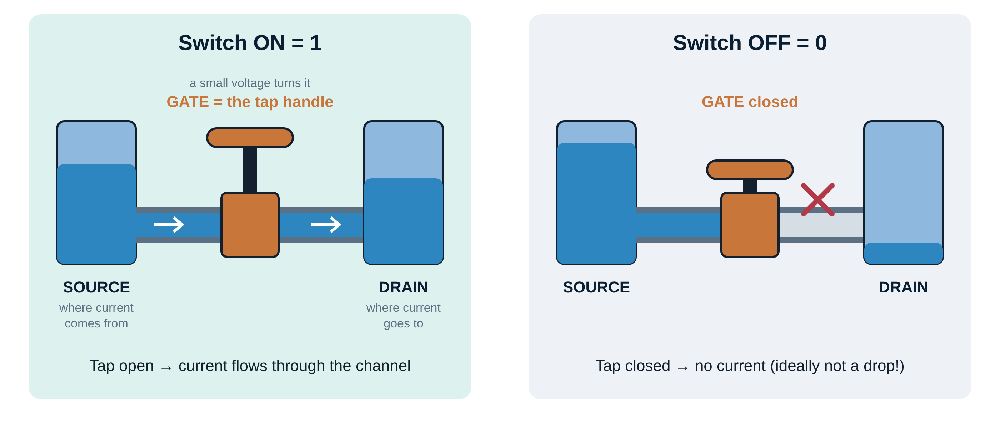
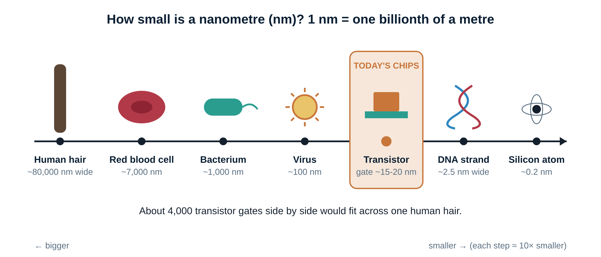
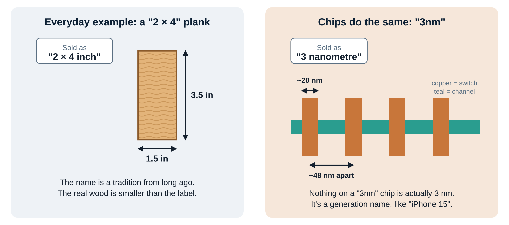
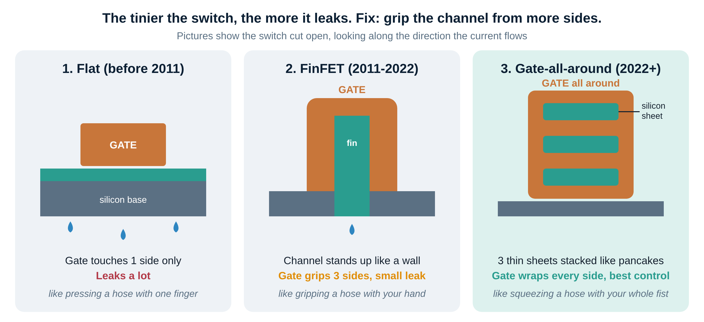
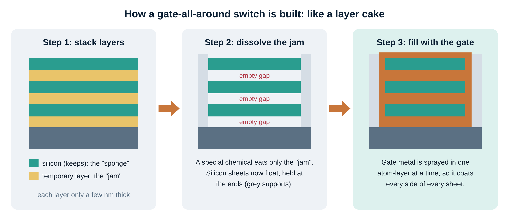
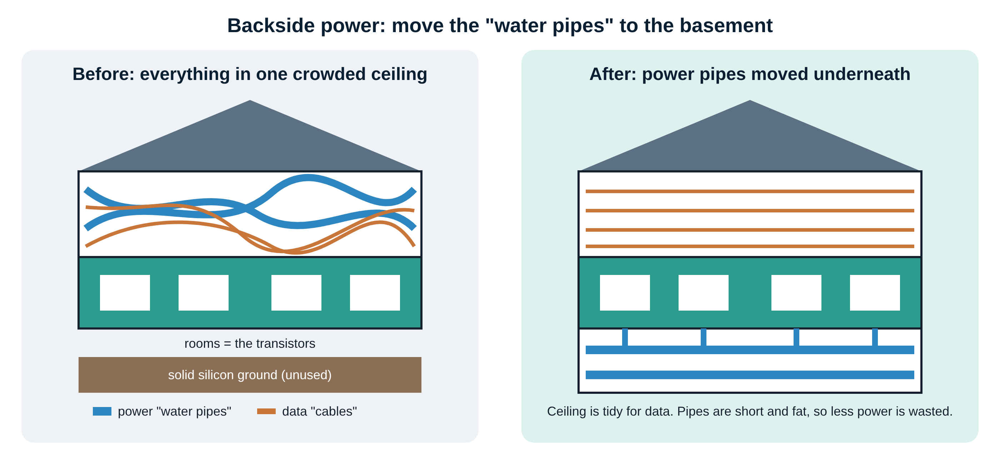

# Week 1: How computer chips work

**No background needed.** Read time is about 30 minutes. There are pictures all the way through.
The slides (`weekly/week-01/week-01-slides.pptx`) and the podcast cover the same ideas.
Want more detail later? There's an optional [technical deep dive](week-01-deep-dive.md).

**By the end you'll be able to explain, in your own words:**
1. What a chip actually is.
2. Why "3nm" is a nickname, not a size.
3. Why tiny switches leak, and the clever fix.
4. Why power wires are moving underneath the switches.

---

## 1. A chip is billions of tiny switches

Open up any phone, laptop or game console and you'll find a **chip**: a flat square of silicon about the size of your fingernail. It's the device's brain.

Zoom into the chip and you'll find different areas for different jobs. One runs apps, one draws graphics, one does AI. Zoom in further and every area is made of the same building block: a microscopic **switch** called a **transistor**.

A switch can only be **ON (1)** or **OFF (0)**. Combine billions of them and you can do maths, store photos, play video and run AI. Every message you've ever sent was turned into ones and zeros by these switches.

### A transistor works like a water tap

| Tap | Transistor |
|---|---|
| Water tank you draw from | **Source**, where electric current comes from |
| Pipe | **Channel**, the path current flows along |
| Where the water goes | **Drain**, where the current goes |
| Tap handle | **Gate**, the control. A small voltage opens or closes it. |

**Example:** when you tap a letter on your keyboard, millions of these taps open and close in a pattern that means "the letter A".

### Real numbers

| Year | Chip | Number of transistors |
|---|---|---|
| 1971 | Intel 4004 (first single-chip processor) | **2,300** |
| 2000 | Intel Pentium 4 (desktop PC) | **42 million** |
| 2023 | Apple A17 Pro (iPhone 15 Pro) | **19 billion** |

The chip stayed about the same size. The switches got smaller, so millions of times more fit in.

---

## 2. How small is small?

A **nanometre (nm)** is one billionth of a metre. Some comparisons:
- A human hair is about **80,000 nm** wide.
- A virus is about **100 nm**.
- The control part (gate) of a modern transistor is about **15–20 nm** long.
- A silicon atom is about **0.2 nm**.

So you could line up about **4,000 transistor gates across one hair**. We're getting close to the size of atoms, which is why each new step is so hard.

### Why do we want smaller switches?
1. **More switches in the same space**, so more features (better camera processing, AI).
2. **Faster**, because signals travel shorter distances.
3. **Longer battery life**, because smaller switches use less energy to flip.
4. **Cheaper per switch**, because more chips fit on each silicon disc (wafer).

---

## 3. "3nm" is a nickname, not a size

**Everyday example:** a piece of wood sold as a "2 × 4" actually measures 1.5 × 3.5 inches. The name is a tradition that stuck.

Chips work the same way. Thirty years ago a chip generation's name matched the size of its switches. Then the two drifted apart, but the names kept counting down each generation: 28 → 20 → 14 → 10 → 7 → 5 → 3 → 2.

On a "3nm" chip:
- the switch's gate is about **20 nm** long,
- switches sit about **48 nm** apart,
- **nothing is actually 3 nm**.

So "3nm" really means "the generation after 5nm", just like "iPhone 15" means the one after iPhone 14.

> **Remember:** compare chips by what they *do*: speed, battery life and cost. Ignore the "nm" in the name.

---

## 4. The problem: tiny switches leak

When a switch gets very small, the gate (the tap handle) starts losing control. Current sneaks through even when the switch is OFF, like a tap that **drips**. Billions of dripping switches waste battery and make your phone warm.

**The fix:** grip the channel from more sides. Think of stopping water in a garden hose:

| Design | Years | How the gate grips | Hose example |
|---|---|---|---|
| **Flat** (planar) | before 2011 | from 1 side (on top) | pressing with one finger, leaks a lot |
| **FinFET** | 2011–2022 | from 3 sides; the channel stands up like a wall, or "fin" | gripping with your hand |
| **Gate-all-around (GAA)** | 2022 onwards | all the way around thin stacked sheets | squeezing with your whole fist |

**Timeline:** Intel made FinFETs first (2011). Samsung shipped gate-all-around first (2022). TSMC and Intel moved to it around 2025. Next, in the 2030s, comes stacking two switches on top of each other.

---

## 5. How do you build a gate-all-around switch?

You can't slide metal into a gap a few nanometres wide. So engineers use a **layer cake** trick:
1. **Stack layers:** alternate silicon (the "sponge" you keep) and a temporary material (the "jam"). Each layer is only a few nanometres thick.
2. **Dissolve the jam:** a chemical eats only the temporary layers. Now the silicon sheets float, held at their ends.
3. **Fill with the gate:** the gate material is deposited one atom-thick layer at a time, so it coats every side of every sheet.

This needs very precise machines. That's why companies that make chip-making machines (Applied Materials, Lam Research, Tokyo Electron, ASML) benefit when chips move to new designs.

---

## 6. Next trick: power from underneath

Above the switches, a chip has **more than ten layers of tiny wires**. Some carry **data** (the ones and zeros) and some carry **power** (the electricity the switches need).

**Example:** imagine a house where the water pipes and internet cables are all crammed into the same ceiling. It's messy, and the long thin pipes lose water pressure.

**Backside power** moves the power pipes to the **basement**:
- the chip is flipped over and the power wiring is built underneath the switches,
- the ceiling is left tidy for data wires,
- power pipes are shorter and fatter, so less electricity is wasted.

Intel calls this **PowerVia**. TSMC calls it **Super Power Rail**.

---

## 7. Who makes these chips?

Only **three companies** can make the most advanced chips:

| Company | Country | What they do | Who they make chips for |
|---|---|---|---|
| **TSMC** | Taiwan | World's biggest chip-making company (a **foundry**: makes chips for others) | Apple, Nvidia, AMD, Qualcomm |
| **Samsung** | South Korea | Makes its own chips and some for others; first to gate-all-around | Its own Galaxy phones, others |
| **Intel** | USA | Famous for PC chips; now wants to make chips for others too | Its own PC and server chips |

**Example:** Apple *designs* the iPhone chip, but TSMC *manufactures* it. One advanced chip factory costs over **$20 billion** to build.

### Why this matters to you
- **Jobs:** every new switch design creates work designing circuits, testing them and managing heat. India has large chip-design centres for Intel, Qualcomm, Nvidia, AMD, Synopsys and Cadence.
- **Investing:** new designs tend to benefit the factories (TSMC), the machine makers (ASML, Applied Materials, Lam Research) and the chip-design software makers (Synopsys, Cadence). *This is not investment advice.*

---

## Words to know

| Word | Plain meaning |
|---|---|
| Transistor | A tiny on/off switch |
| Gate | The switch's control, like a tap handle |
| Channel | The path current flows through |
| Nanometre (nm) | One billionth of a metre |
| Node (e.g. "3nm") | A chip generation's name |
| FinFET | Switch with the gate on 3 sides |
| Gate-all-around (GAA) | Switch with the gate on all sides |
| Backside power | Power wires moved under the switches |
| Wafer | Thin silicon disc that chips are made on |
| Foundry | A company that makes chips for others |

---

## Check yourself

Try answering out loud first, then open the answers.

1. What is a transistor?
2. Is anything on a "3nm" chip actually 3 nm?
3. Give one everyday example of a name that doesn't match the real size.
4. Why do tiny switches leak?
5. How did engineers fix leaking?
6. In the layer-cake method, what happens to the "jam"?
7. What does backside power do?
8. Apple designs iPhone chips. Who manufactures them?

Answers

1. A tiny on/off switch. A chip has billions of them.
2. No. It's a generation name.
3. A "2 × 4" plank of wood is really 1.5 × 3.5 inches. "iPhone 15" is a name, not a measurement.
4. The gate loses control of the channel, so current slips through even when the switch is OFF.
5. By wrapping the gate around more sides of the channel: 1 side, then 3 (FinFET), then all sides (gate-all-around).
6. A chemical dissolves it, leaving gaps that are then filled with gate material.
7. It moves the power wires under the switches, freeing space for data wires and wasting less electricity.
8. TSMC, a foundry in Taiwan.

**Next week:** how chips are printed using light, and why only one company in the world makes the machines that do it.
